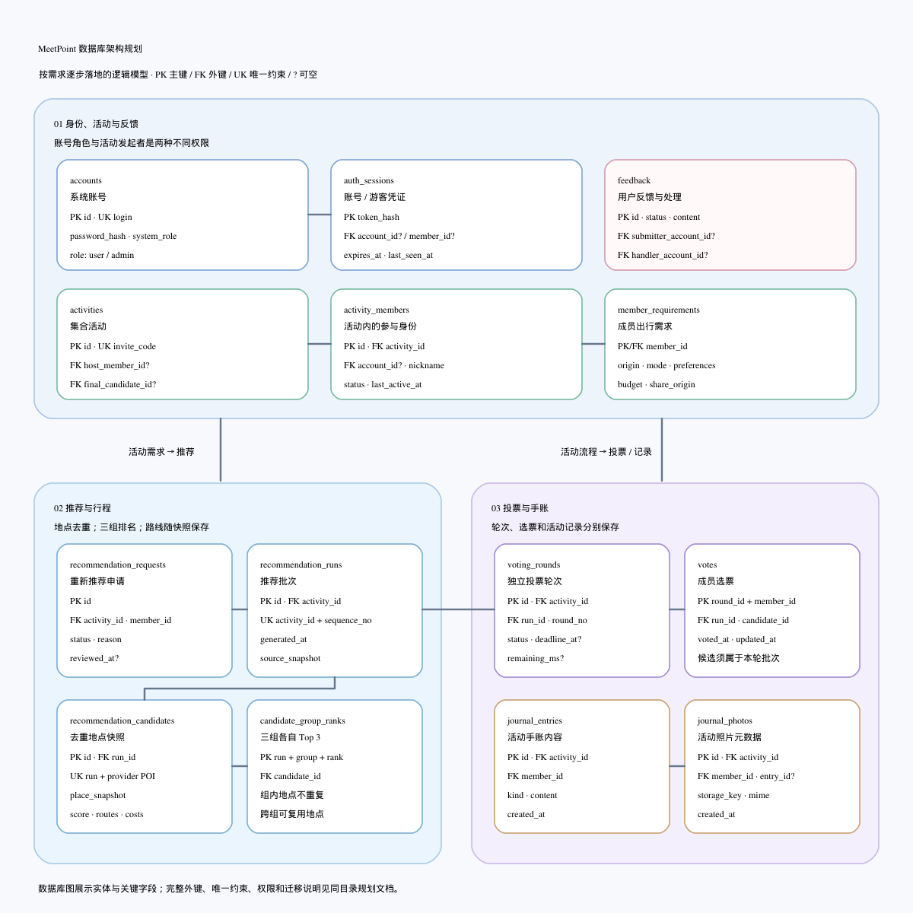
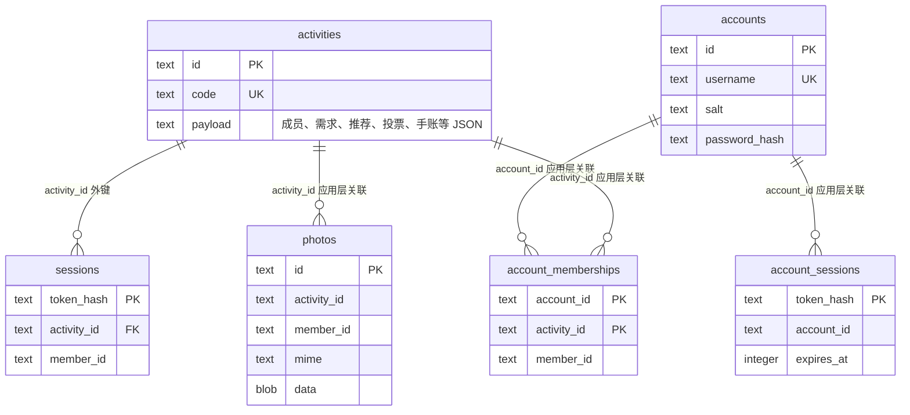

# MeetPoint 数据库规划

> 版本：V1.1｜日期：2026-10-28｜性质：按需求演进的逻辑模型，不是必须一次建成的表清单。
> 依据：《MeetPoint 软件需求规格说明书》V1.1、项目里程碑规划及现有 Demo 的活动、投票和手账规则。

## 1. 架构图

上图为 **1200 × 1200 的正方形矢量图**，适合直接插入 PPT。图中每张卡片是一种将来可能需要独立查询或约束的关系实体，箭头只画主要业务关联；它不表示 Sprint 1 必须迁移成这些表。地图服务是外部数据源，不是本地数据库表。

### 当前 Sprint 1 的物理存储

当前代码建立 6 张 SQLite 表，与上面的逻辑模型处于不同层次：

图中仅 `sessions.activity_id` 已声明数据库外键。其他连线目前由应用层维护；`account_memberships` 还约束 `(activity_id, member_id)` 唯一。浏览器本地的反馈不在这 6 张表中。Sprint 1 验收应以当前功能与实际存储为准，不以目标图的表数为准。

## 2. 设计选择

- 继续使用关系型数据库 SQLite。当前活动聚合 JSON 足以支撑单实例 Sprint 1；当用户故事需要独立查询、跨记录约束或多人并发写入时，再逐步拆出成员、需求、推荐批次、三组排序、投票轮次与选票。偏好细项、地点与评分依据、逐成员路线和费用可以保留为推荐时的 JSON 快照。
- 注册账号与活动身份分离。`accounts.system_role` 表示全站的 `user` 或 `admin`；`activity_members` 表示一个人在某场活动中的身份。`activities.host_member_id` 决定该活动的发起者，不能授予系统管理员权限。
- 活动可以同时有游客与注册成员。游客不需要 `accounts` 行；其活动身份由不可预测的会话令牌访问。数据库只保存令牌摘要。注册成员通过账号会话访问与账号关联的活动身份。
- 每次推荐保存不可变的候选快照。后续需求修改不回写已开启投票的候选；重新推荐生成新批次。零票重投可引用原推荐批次，但新建投票轮次，旧选票不继承。
- 当前照片以 BLOB 保存在 SQLite。若照片规模或部署需求使文件存储更合适，再把文件放入持久化磁盘或对象存储，并在数据库保存 `storage_key`、类型及归属；这不是 Sprint 1 的必要迁移。

## 3. 表与主要字段

图中 `PK` 为主键，`FK` 为外键，`UK` 为唯一约束，`?` 为允许空值。下表是后续拆表时的设计候选，不是当前建表脚本。新增业务表宜有创建时间；可变记录另有更新时间。时间统一保存为 UTC，页面按用户时区显示。

| 表 | 主键与主要字段 | 用途及关键约束 |
| --- | --- | --- |
| `accounts` | `id`；`login`（UK）、`password_hash`、`system_role`、`created_at` | 注册、登录及管理员授权。角色限定 `user/admin`；密码只存安全哈希。 |
| `auth_sessions` | `token_hash`；`account_id?`、`member_id?`、`expires_at`、`last_seen_at` | 账号会话或游客活动凭证；两种主体字段恰有一个非空。令牌明文只返回客户端。 |
| `activities` | `id`；`invite_code`（UK）、`title`、`type`、`scheduled_at`、`status`、`host_member_id?`、`final_candidate_id?` | 活动主记录；最终候选在完成后不可修改。建活动与指定发起者在同一事务完成。 |
| `activity_members` | `id`；`activity_id`、`account_id?`、`nickname`、`status`、`joined_at`、`last_active_at` | 记录游客或账号用户在某活动中的身份。注册账号在同一活动最多一条有效成员记录；有效成员最多 10 人。 |
| `member_requirements` | `member_id`（PK/FK）；`origin_label`、`origin_lat`、`origin_lng`、`travel_mode`、`preferences_json`、`budget`、`share_origin`、`updated_at` | 一名成员的一份当前需求；精确位置供服务端推荐，响应时根据 `share_origin` 控制对其他成员的展示。 |
| `feedback` | `id`；`submitter_account_id?`、`guest_receipt_hash?`、`category`、`content`、`status`、`handler_account_id?`、`handling_note?`、`created_at`、`handled_at?` | 账号用户或游客提交反馈。提交者账号与游客查询凭证二选一；处理者必须是管理员。建议状态 `pending/processing/resolved`。 |
| `recommendation_requests` | `id`；`activity_id`、`member_id`、`reason`、`status`、`created_at`、`reviewed_at?` | 成员申请重新推荐，发起者审批；初次推荐无需申请。 |
| `recommendation_runs` | `id`；`activity_id`、`sequence_no`、`generated_at`、`source_snapshot` | 一次推荐的固定批次；`(activity_id, sequence_no)` 唯一。记录数据来源或算法版本，以便解释评分。 |
| `recommendation_candidates` | `id`；`run_id`、`provider`、`provider_poi_id`、`place_snapshot`、`total_score`、`score_breakdown`、`routes_snapshot` | 保存该批去重后的实际地点及评分、逐成员路线和费用快照。`(run_id, provider, provider_poi_id)` 可作唯一键；无稳定地图 ID 时需定义等价去重键。费用未知时保存明确状态，不以 `0` 冒充已知费用。 |
| `candidate_group_ranks` | `(run_id, group_key, rank)`；`candidate_id` | 保存三类推荐各自的 Top 3 排序；`rank` 限定 1～3，`(run_id, group_key, candidate_id)` 唯一。`candidate_id` 必须属于同一 `run_id`；同一地点可以出现在不同组。 |
| `voting_rounds` | `id`；`activity_id`、`run_id`、`round_no`、`status`、`started_at`、`deadline_at?`、`remaining_ms?`、`closed_at?` | 一轮投票绑定一个固定推荐批次；`(activity_id, round_no)` 唯一。暂停时保存剩余时长，恢复后重算截止时间。 |
| `votes` | `(round_id, member_id)`；`run_id`、`candidate_id`、`voted_at`、`updated_at` | 每成员每轮至多一票；截止前改票为更新原记录。组合外键确保所选候选与轮次引用同一推荐批次。 |
| `journal_entries` | `id`；`activity_id`、`member_id`、`kind`、`content`、`created_at` | 保存活动手账中的感受和评论；作者须属于该活动。 |
| `journal_photos` | `id`；`activity_id`、`member_id`、`entry_id?`、`storage_key`、`mime`、`created_at` | 保存照片元数据及文件位置；删除照片时同时清理文件对象。 |

## 4. 关系与业务约束

1. **活动与成员：** `activities 1:N activity_members`。活动建立时可以先插入活动与发起者，再回填 `host_member_id`，整个过程在一个事务中完成。发起者必须是本活动的有效成员；移交发起权只更新该引用，不改变本轮候选和选票。人数下限 2 人用于开始推荐与投票，上限 10 人用于加入校验。
2. **恢复期限：** `activity_members.last_active_at` 记录最近一次有效操作。未完成活动的游客按 24 小时、账号成员按 7 天判断恢复资格；`auth_sessions.expires_at` 则用于会话本身的安全失效，不能替代前述业务期限。
3. **隐私：** 精确出发坐标只供授权的服务端推荐与本人查看。查询其他成员需求时，服务端依据 `share_origin` 输出脱敏视图，不能依赖前端隐藏字段。
4. **推荐：** `recommendation_runs 1:N recommendation_candidates`，同一批的实际地点去重；`candidate_group_ranks` 为每个推荐组指定最多 3 个地点，三个组的并集可以超过 3 个，同一地点也可出现在多个组。候选快照保存逐成员交通估计；地图失败、数据缺失及费用未知都需明确状态，不伪造结果。只有在需要单独检索或更新路线时才考虑拆出路线表。
5. **投票：** `voting_rounds` 绑定 `recommendation_runs`；`votes` 的 `(round_id, member_id)` 为主键。为防止跨批次投票，`votes.run_id` 同时参与指向轮次和候选的组合外键，或使用等价数据库约束。投票中不得增减成员；计票、提前结束、暂停与恢复在事务中完成。
6. **最终结果：** `activities.final_candidate_id` 只能指向当前有效轮次所属批次的候选；活动完成后不再允许重新推荐、改票或修改结果。选票指向去重地点，不指向某组排名；平票时须定义跨组统一决胜次序（可保存候选的全局排序），零有效票不写入最终结果。
7. **反馈权限：** 游客提交反馈时生成高熵查询凭证，仅存摘要；注册用户通过账号查询本人反馈。只有 `accounts.system_role = admin` 的账号可以更新反馈状态和处理说明，`handler_account_id` 指向该账号。活动发起者身份不提供此权限。

其中“同一活动”“当前有效轮次”“管理员角色”等跨多表条件，应通过事务中的服务端校验实现；能用唯一键、检查约束或组合外键表达的条件同时落实到数据库。

## 5. 建议索引与事务边界

| 访问路径 | 索引 / 约束 |
| --- | --- |
| 邀请码加入 | `activities(invite_code)` 唯一 |
| 查看某账号未完成活动 | `activity_members(account_id, status)`，并联查活动状态 |
| 活动成员与恢复 | `activity_members(activity_id, status)`；按成员主键读取 `last_active_at` |
| 推荐历史 | `recommendation_runs(activity_id, sequence_no)` 唯一 |
| 三组推荐顺序 | `candidate_group_ranks(run_id, group_key, rank)` 主键；`(run_id, group_key, candidate_id)` 唯一 |
| 投票轮次 | `voting_rounds(activity_id, round_no)` 唯一 |
| 本轮选票 | `votes(round_id, member_id)` 主键 |
| 我的反馈 / 管理员待处理列表 | `feedback(submitter_account_id, created_at)`；`feedback(status, created_at)` |

创建及加入活动、生成推荐及候选、提交或改票、截止计票、移交发起权、照片元数据写入，都应以数据库事务完成。加入时应在事务内重新核对有效人数，防止并发超过 10 人。

## 6. 落地与服务器部署

**Sprint 1 暂不做结构迁移。** 当前 Demo 用 `activities.payload` JSON 保存活动状态，`sessions` 保存游客令牌摘要，`accounts`、`account_sessions`、`account_memberships` 保存账号及其活动身份，`photos` 在 SQLite 中保存二进制图片；反馈只在浏览器本地。使用 SQLite 外键约束时，须在每次打开连接时启用检查；现有表中只有 `sessions.activity_id` 声明了外键，其他跨表关系仍由应用层保证。

后续按用户故事逐步拆分时，先明确新的独立查询或约束，再设计迁移。迁移必须保留旧数据并避免同时维护 JSON 与新表两套事实来源；完成前后核对活动数、成员数、三组候选顺序、每轮选票数和最终结果。逻辑模型中的 `auth_sessions` 只是账号与游客凭证的统一概念，实际实现可以继续使用 `sessions` 与 `account_sessions` 两张表。若将账号关联直接放进 `activity_members`，应评估是否仍需 `account_memberships`，避免重复关系。

部署到**单台服务器**时可继续使用 SQLite 文件和其中的照片 BLOB，放在持久磁盘并配置备份、HTTPS 和服务自启动。若以后运行多台后端或需要更强的并发写入，再评估 PostgreSQL；这会涉及字段类型、SQL 方言、连接方式和数据迁移。部署地点变化本身不要求改变业务实体关系。

## 7. SRS 对应

| 需求范围 | 数据设计支撑 |
| --- | --- |
| FR-01～07、FR-19～22、FR-29、FR-33～37 | 活动、成员、账号、会话、需求、位置公开、发起者及恢复期限 |
| FR-08～11、FR-18、FR-23～25、FR-31、FR-38 | 推荐批次、候选快照、地图来源、逐成员路线与费用状态 |
| FR-12～16、FR-26～27、FR-30、FR-39～40 | 投票轮次、选票、重荐申请、最终候选与倒计时 |
| FR-17、FR-28、FR-32；NFR-14 | 用户反馈、处理状态及管理员权限隔离 |

图示强调需求覆盖与可读性；具体拆表范围以实施时的用户故事和约束为准。
